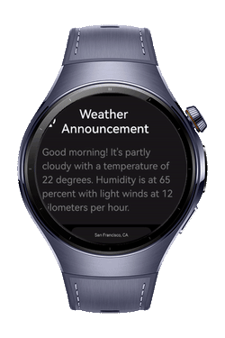
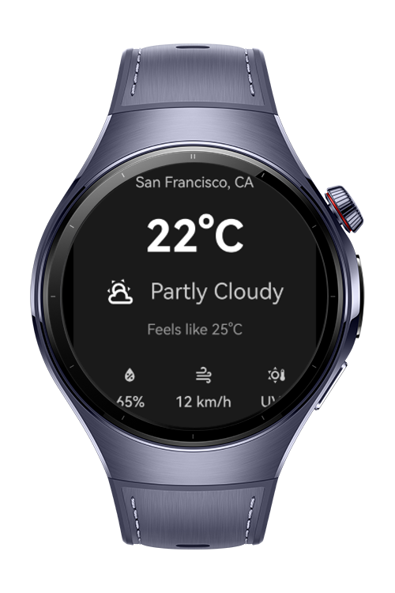
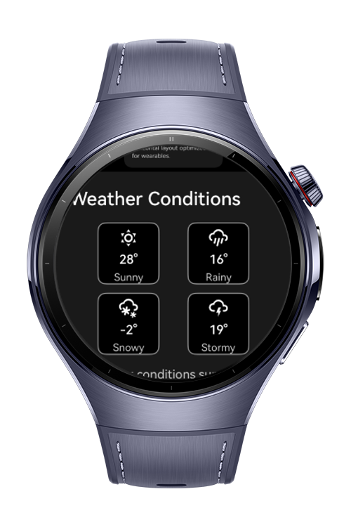
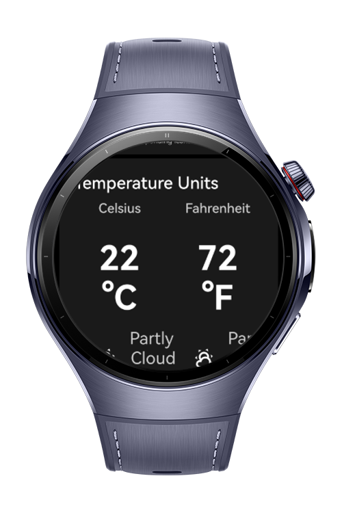

> **Note:** To access all shared projects, get information about environment setup, and view other guides, please visit [Explore-In-HMOS-Wearable Index](https://github.com/Explore-In-HMOS-Wearable/hmos-index).

# How to Implement Weather Features for HarmonyOS Wearables

This is a collection of weather UI components specifically designed for HarmonyOS wearable devices with circular displays.


# Preview

<p align="left">
  
  
  
  
</p>

# Use Cases

WeatherKit can be used for any app wanting to integrate weather related features. Including examples such as;
- **Weather Apps:** Ready components for displaying current conditions, forecasts and weather details.
- **Outdoor Applications:** Show weather conditions relevant to outdoor activity applications such as fitness apps.
- **Voice-enabled interfaces:** Accessibility integrations that want to implement audio-synchronized text highlighting.

# Tech Stack

- **Framework:** HarmonyOS SDK (ArkTS/ArkUI)
- **UI Components:**
    - ArcList for circular wearable interface
    - Custom components optimized for OLED display(Pure black backgrounds for better battery life and performance)


# Directory Structure

```
WeatherKit/
│
├── entry/
│   └── src/
│       └── main/
│           ├── ets/
│           │   ├── components/                     #Common components to use across the app
│           │   │   └── CurrentWeatherCard.ets
│           │   │   └── ForecastCard.ets
│           │   │   └── TTSAnnouncementCard.ets
│           │   │   └── WeatherDetailsRow.ets
│           │   ├── constants/
│           │   │   ├── WearableLayout.ets          #Size and spacing constants
│           │   │   └── WeatherTheme.ets            #Color and text constants
│           │   ├── pages/                          
│           │   │   └── WeatherCardsShowcase.ets    #Showcase screen displaying all components
│           │   ├── types/
│           │   │   ├── WeatherTypes.ets            #Common interfaces used across the app
│           │   ├── utils/
│           │   │   └── WeatherIconHelper.ets       #Icon loader and helper service
│           └── resources/
│               └── base/
│                   └── media/                      #Weather icon svgs
```

# Constraints and Restrictions

## Supported Devices;

- **HarmonyOS Wearable Devices**: Any Wearable device running HarmonyOS with:
    - Circular Display
    - Minimum HarmonyOS API Level 18


# License

**WeatherKit** is distributed under the terms of the MIT license. See the [LICENSE](LICENSE) for more information.
